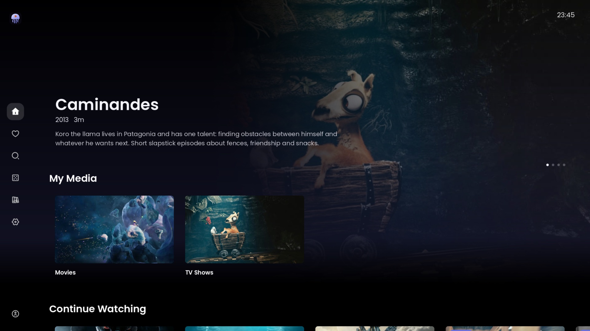
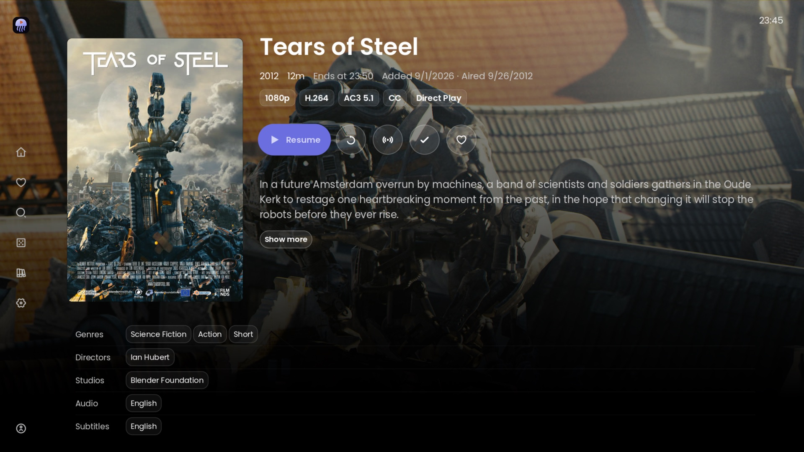
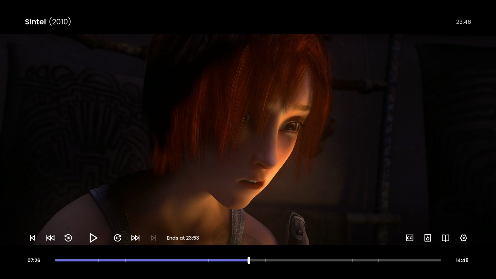

# JellyRust

[](https://github.com/mac-lucky/jellyrust/actions/workflows/ci.yml)
[](https://github.com/mac-lucky/jellyrust/releases/latest)
[](LICENSE)

A native Jellyfin client for LG webOS TVs with the look of
[Litefin](https://github.com/MoazSalem/litefin), forked from
[Native Jelly](https://github.com/sostk/native-jelly).

JellyRust draws its interface directly on the GPU and hands video to the TV's own hardware decoder,
so it is not a web page wrapped in an app. It installs as its own app, beside Native Jelly or
Litefin, and shares no sign-in or data with either.

## What it looks like

<p align="center">
  
</p>

<p align="center">
  
  
</p>

<p align="center"><em>Home &nbsp;|&nbsp; A film's page &nbsp;|&nbsp; Playback</em></p>

The screenshots show openly licensed films from the Blender Foundation and others, credited in
[CREDITS.md](docs/screenshots/CREDITS.md).

## Features

- Sign in to your Jellyfin server with a Quick Connect code approved from another device
- Several Jellyfin users on one TV, with **Who's watching?** at start
- Home, your libraries, Favorites, Random, Search and Continue Watching
- Plays a file directly when the TV can decode it; anything else is converted by your server, which
  also records where you stopped and what you finished
- Audio and subtitle tracks follow what your server remembers for you, with a preference for dubbed
  or voice-over audio
- The Litefin look: a pure black theme, the left rail, Litefin's home rows, detail pages and player
  controls. It is reproduced from measurements of Litefin's source and screenshots; no Litefin code
  is used ([docs/litefin-look.md](docs/litefin-look.md))
- English, Polish, Spanish, Russian and Belarusian
- No crash reporting or analytics: the only server the app talks to is yours
  ([PRIVACY.md](PRIVACY.md))

Movies and TV shows only: no music, photos or live TV.

## Installation

1. Download `com.macluckylab.jellyrust_<version>_arm.ipk` from the
   [latest release](https://github.com/mac-lucky/jellyrust/releases/latest).
2. Install it with the [Homebrew Channel](https://github.com/webosbrew/webos-homebrew-channel) or
   [dev-manager-desktop](https://github.com/webosbrew/dev-manager-desktop). You do not need a
   rooted TV.
3. Sign in with Quick Connect. **Never type a password into the app**: it logs keys and typed text
   to `/tmp` on the TV.

Video playback is verified on two TVs: an LG C1 (2021) on webOS 6.5.3 and an LG C5 (2025) on
webOS 10.3.1. On every other firmware from webOS 4.0 up the app is only known to pass webosbrew's
static compatibility check. If you try it on
another set, please [report what happened](https://github.com/mac-lucky/jellyrust/issues), whether
it worked or not.

## Building

The toolchain setup and build requirements are in [docs/building.md](docs/building.md).

```bash
make ipk                              # debug flavour: pkg/com.macluckylab.jellyrust.debug_<version>_arm.ipk
make FLAVOR=stable RELEASE=1 ipk      # stable: pkg/com.macluckylab.jellyrust_<version>_arm.ipk
make check                            # host unit tests and lint gates
```

The debug flavour installs as its own app beside the stable one, with its own tile, sign-in and
data.

## Lineage

```
JellyRust (macluckylab)
  <- Native Jelly by sostk          https://github.com/sostk/native-jelly
       <- PlxNative by Gleb Linnik  https://github.com/GLinnik21/plx-native
```

JellyRust is Native Jelly modified by [macluckylab](https://macluckylab.com): rebranded, reskinned
to the Litefin look and with telemetry removed. Native Jelly is itself a Jellyfin port of
PlxNative. The people who wrote the code this builds on are listed in
[CONTRIBUTORS.md](CONTRIBUTORS.md).

## Support

For bugs and feature requests, please use the
[GitHub issue tracker](https://github.com/mac-lucky/jellyrust/issues). Include your TV model, webOS
version and JellyRust version. Report security problems privately, as described in
[SECURITY.md](SECURITY.md).

## License

GPL-3.0-or-later, see [LICENSE](LICENSE) and [LICENSING.md](LICENSING.md). Third-party components
keep their own licences ([THIRD-PARTY-NOTICES.md](THIRD-PARTY-NOTICES.md)); names and marks:
[TRADEMARKS.md](TRADEMARKS.md).

JellyRust is an independent, unofficial project, not affiliated with or endorsed by Jellyfin, LG
Electronics, Native Jelly, PlxNative or Litefin.
